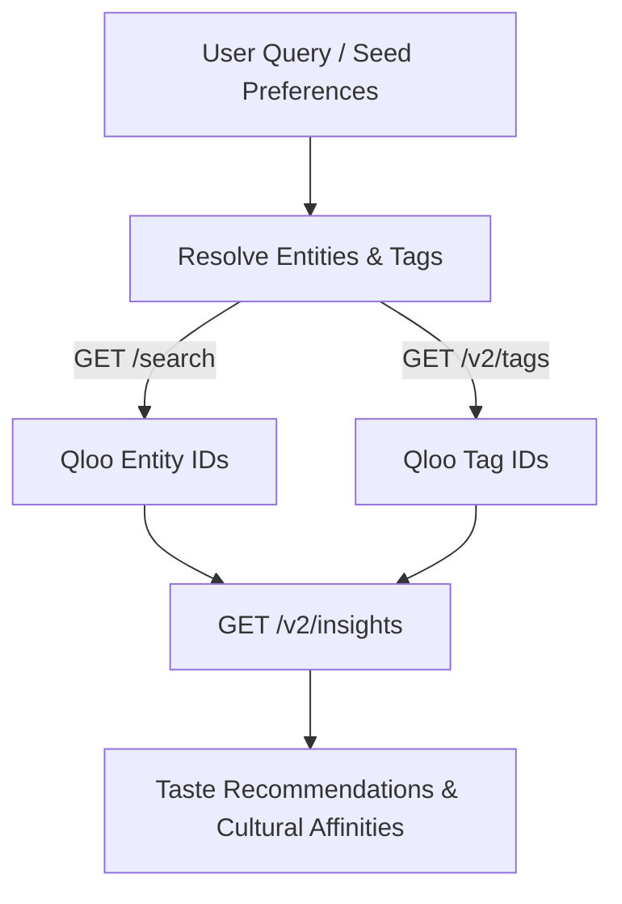

# Veritype

> Cultural intelligence and taste-driven discovery powered by Qloo's AI and Insights APIs.

---

## 📖 Overview

**Veritype** is an agentic, taste-intelligence application designed for the **Qloo Hackathon**. It leverages Qloo’s taste graph to map, analyze, and predict cultural affinities across entertainment, lifestyle, media, and consumer preferences.

---

## ⚡ Qloo Hackathon Integration Guide

### 1. API Configuration

| Parameter | Value |
| :--- | :--- |
| **Base URL** | `https://hackathon.api.qloo.com` |
| **Auth Header** | `X-Api-Key: <YOUR_API_KEY>` |
| **Method** | `GET` (Parameters in query string, not JSON body) |

> ⚠️ **Note**: Hackathon keys only work with `https://hackathon.api.qloo.com`. Calls to staging or production URLs will return `401 Unauthorized`.

---

### 2. Core Endpoints & Flow



#### A. Lookup & Resolution
* **Search Entities (`GET /search`)**: Converts names (e.g., movies, artists, books, places) into canonical Qloo Entity IDs.
* **Search Tags (`GET /v2/tags`)**: Resolves keywords and genres into valid Qloo Tag IDs.
* **Entity Details (`GET /v2/entities`)**: Retrieves detailed metadata and properties for specific entity IDs.

#### B. Insights & Recommendations (`GET /v2/insights`)
The core engine for querying cultural affinities. Parameters must be passed in the URL query string:
* `filter.type`: Target recommendation category (Required).
* `signal.interests.entities`: Comma-separated list of seed entity IDs representing input tastes.
* `signal.interests.tags`: Comma-separated list of seed tag IDs.
* `signal.demographics.audiences`: Target demographic audience URNs.
* `filter.tags`: Narrow recommendations to specific tags.

> 🚫 **Legacy endpoints**: Do **not** use `/recommendations` or `/recs`.

---

### 3. Supported Entity Categories (`filter.type`)

When requesting recommendations from `/v2/insights`, the `filter.type` parameter must be one of the following 10 supported URNs:

* `urn:entity:artist` *(Music artists & bands; do not use `urn:entity:music`)*
* `urn:entity:movie`
* `urn:entity:tv_show`
* `urn:entity:book`
* `urn:entity:podcast`
* `urn:entity:video_game`
* `urn:entity:brand`
* `urn:entity:destination`
* `urn:entity:place` *(Restaurants, bars, venues; do not use `urn:entity:food_and_drink`)*
* `urn:entity:person`

---

### 4. Implementation Best Practices

1. **Exact IDs Only**: The Insights API requires official Qloo Entity IDs and Tag IDs. Always resolve user input via `/search` or `/v2/tags` before querying `/v2/insights`.
2. **Entity Compatibility**: Different entity categories accept different filter parameters. Unsupported parameters are silently ignored by the API rather than returning an error.
3. **Response Parsing**: The API returns comprehensive entity records including popularity, external links, and imagery. Field filtering is performed on the application layer.
4. **Caching**: Private backend caching is enabled to minimize latency and optimize rate limits.

---

## 🚀 Getting Started

### Prerequisites

* Node.js (v20+ recommended)
* npm / bun

### Environment Setup

1. Copy the sample environment file:
   ```bash
   cp .env.example .env
   ```

2. Add your Qloo Hackathon API key to `.env`:
   ```env
   QLOO_API_KEY="your_api_key_here"
   QLOO_BASE_URL="https://hackathon.api.qloo.com"
   QLOO_TRUSTED_BASE_URL="https://hackathon.api.qloo.com"
   ```

3. Configure the CLI harness (optional):
   ```bash
   qloo config set api-key YOUR_API_KEY
   qloo config set base-url https://hackathon.api.qloo.com
   ```

---

## 📄 License

MIT